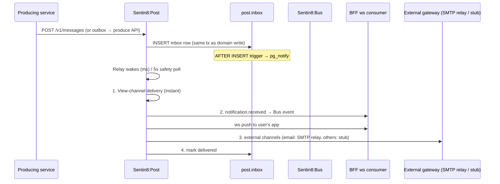

# Design Doc: Sentin8:Post - Multi-Channel Message Delivery

## 1. Summary

Sentin8:Post is the platform's message-delivery service. Messages are
enqueued into a durable `inbox` (same-transaction as the domain
change), drained by a hybrid LISTEN/NOTIFY + safety-poll relay, and
delivered through an in-app "View" channel plus Bus-produced
`notification.received` events (the BFF's WebSocket consumer pushes
them to connected apps) and external gateways (email/push/SMS -
provider-backed).

## 2. Motivation

- **Messages must not vanish.** A domain event that triggers a
  notification must not lose it if the consumer is down; the outbox +
  inbox pattern makes send and deliver independently durable.
- **One delivery surface, many channels.** In-app, push, email, and
  future SMS channels all compose over one message record - the
  sender declares the message; delivery channel resolution is Post's
  job.
- **Real-time plus reliability.** Users expect millisecond in-app
  notifications; the hybrid relay (LISTEN/NOTIFY wake + 5s safety
  poll) gives latency without depending on notifications for
  correctness.
- **Gateway credentials by reference.** External channel credentials
  (SMTP keys, FCM tokens) resolve through the shared Secrets chain at
  delivery time - never stored in rows.

## 3. Architecture & High-Level Design

- **Relay model** - `PgListener` on `post_inbox_changed` wakes the
  relay in milliseconds; a 5-second safety poll catches missed
  notifications and recovers from crashes (same model as Bus).
- **Channel resolution** - every message gets the View channel (always
  available); configured gateways (`sentin8_post_gateways`) add
  external channels; gateway `config` JSONB may carry a
  `{"secret_ref": "backend://path"}` resolved at delivery time.
- **Unread counts** - mark-read produces
  `sentin8:notification:read` events so every user device's badge
  updates.

## 4. Key Traits and Data Structures

- **`inbox`** - the durable message queue (RLS env-scoped, AFTER
  INSERT trigger → `pg_notify('post_inbox_changed')`).
- **`sentin8_post_gateways`** - per-env delivery gateway
  configuration (channel type, secret reference, enabled flag).
- **`ProduceRequest`** - the Bus contract Post uses for
  `notification.received` / `notification:read` events (envelope
  carries user, category, resource refs, unread count).
- **Delivery record** - per-message status transitions
  (`pending → delivered` with channel receipts).

## 5. Rationale, Trade-offs, and Alternatives

- **Inbox + relay over direct delivery.** The producer writes one inbox
  row in the same transaction as its domain change - the notification
  becomes as durable as the domain fact itself. Direct HTTP delivery
  would either couple the producer to Post's availability or lose
  notifications on failure.
- **Hybrid LISTEN/NOTIFY + safety poll.** Pure LISTEN misses
  notifications during connection blips; pure polling adds up to
  interval latency. Hybrid gives millisecond wakeups with a bounded
  catch-up - the same model Bus uses, so operators know one pattern.
- **View channel always delivered.** The in-app record is the source
  of truth; external channels are additive (a FCM outage never loses
  the message). External channels are retries, not the record.
- **Events for in-app push.** The relay produces
  `notification.received` and the BFF's WebSocket consumer pushes to
  the user's connected app - Post stays unidirectional; the
  transport-tier rule (WS only for chat, SSE for pushes, HTTP for
  queries) is respected by producing through the Bus instead of
  opening a Post→BFF socket.
- **Secret references for gateway credentials.** `backend://path`
  refs resolve via the shared Secrets chain at delivery time - a DB
  dump never contains provider keys, and rotation needs no restart.
- **SMTP via HTTP relay adapter (target state).** The email channel
  rides a real SMTP relay when the gateway row declares
  `config.gateway_url` (a self-hostable SMTP-to-HTTP bridge endpoint);
  the relay owns the SMTP conversation with the upstream MTA. The
  rendered subject/body (templates, POST-7) flow to the relay; row
  literals are the fallback. Channels without a real adapter (sms,
  push, web_push, mail) keep the stub dispatch behind the same
  `gateway_dispatch` seam.
- **Idempotent mark-read events.** Idempotency keys
  (`{action}-{message_id}`) make at-least-once delivery
  effectively-once for badge counters.
- **Rejected: per-service notification emitters.** Every service would
  re-implement channel resolution, retries, and receipts; Post
  centralizes delivery so one gateway config change covers the
  platform.
- **Rejected: Postgres-only queues with polling consumers.** The same
  latency/reliability trade-off as Bus; the hybrid relay resolves it.

## 6. Internal Implementation & Invariants (Private Design)

- **Invariants:**
  - Every message send writes the inbox row in the SAME transaction as
    the domain change (inbox-first; a Post outage never loses a
    notification).
  - The relay delivers View-channel first (the record), then external
    gateways (best-effort, receipted).
  - Gateway credentials resolve at delivery time from secret
    references - never stored plaintext; resolved values are held only
    for the duration of the delivery.
  - Event names follow `vertical:service:resource:operation` (colons
    only) - pinned by tests.
  - RLS context is set on the same connection inside the same
    transaction as every inbox/gateway query.
  - Marked-delivered messages are terminal (no double delivery);
    a replayed relay pass skips delivered rows.
- **Boot (shell-owned).** The shell owns the listener stack; Post
  builds its capped pool, consumes the Shield engine, spawns the
  inbox relay (PgListener + safety poll), and mounts the API + admin
  UI (with the shared Shield policy-admin surface mounted in routes).
- **Policy admin.** Post exposes the full Shield policy-admin surface
  (policy sets, relations, attributes, Policy Studio aliases) - the
  shared implementation, not a fork.

## 7. Unresolved Questions / Future Designs

- FCM/APNs push adapters land behind the same `gateway_dispatch` seam
  as the SMTP relay (the seam is the contract; retry/DLQ machinery is
  already adapter-agnostic).
- User-level channel preferences live in `notification_preferences`
  (`(env, user) → muted_categories[], quiet-hours window`); the relay's
  fan-out filter consults them before external channels attempt - the
  View channel always delivers (post DESIGN §10).
- Read receipts are emitted as `sentin8:post:notification:read` events
  on mark-read (local outbox, post DESIGN §4).
- Message templates live in `post.templates` (`(env, key, locale) →
  subject/body`), rendered at delivery time with `{{var}}` substitution;
  branding (`primary_color`, `logo_url`) resolves from `sys.branding`
  into the render vars (env override over org base, non-empty wins).
  A producer requests one via `metadata.template_key` (+ optional
  `metadata.locale` / `metadata.template_vars`); an unresolvable
  template falls back to the producer's literal subject/body.

---

**Architecture & Design:** sentin8:post and its underlying concepts were designed by [Hamid Jahanzad](https://www.linkedin.com/in/hamidjahanzad/).
